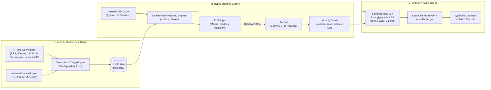

# Resumatch

> **Idioma / Language:** **English** | [Português (Brasil)](./README.pt-BR.md)

**Resumatch** is a local-first, privacy-hardened job discovery, deterministic 3-axis triage, and hybrid ATS-clean A4 resume studio built with **FastAPI**, **SQLModel (SQLite WAL)**, **Pydantic v2**, **Playwright Headless Chromium**, and **React + TypeScript + Pure Vanilla CSS**.

Designed to eliminate prompt-driven manual `.docx` editing and token-heavy LLM pipelines, Resumatch runs **95%+ of its core intelligence with Zero AI** while offering an optional single-shot **Surgical AI** fine-tuning mode guarded by reversible PII masking and post-LLM veracity verification.

---

## Architectural Highlights



### 1. Unified 3-Axis Deterministic Triage Engine (Zero AI)
Every discovered or manually imported job opportunity is evaluated locally in milliseconds across three orthogonal axes:
- **Axis 1 — Professional Compatibility:** Lexical skill extraction with section-aware mandatory vs. desirable detection, negation parsing, career-tier signals, geography rules, daytime schedule bounds, contract policy, and private employer blocklist matching. Maps skills against four veracity states: `confirmed_practice`, `academic_foundation`, `preparable_gap` (attaches internal `study_plan` cards for interview prep), and `unconfirmed`.
- **Axis 2 — Operational Status & Omissions:** Separates concrete incompatibilities from operational omissions (e.g., undisclosed salary or hybrid details), never blocking local resume preparation due to missing metadata.
- **Axis 3 — Ethical Automation Tiers (1 / 2 / 3):** Classifies each vacancy into Tier 1 (public discovery & direct channel), Tier 2 (local assisted preparation), or Tier 3 (authenticated ATS portals), strictly prohibiting blind automated form submissions or anti-bot/CAPTCHA bypassing.

### 2. Hybrid Resume Studio (`Deterministic` + `Surgical AI`)
- **Deterministic Mode (`< 20ms`, Zero Tokens):** Scores and selects verified bullets, skill groups, courses, and localized summaries (`pt-BR` and `en-US`, including `suporte-en`) from `MasterProfile` presets, applying audited contextual equivalences and dynamic section ordering.
- **Surgical AI Mode (Single-Shot + Zero PII):**
  - **`PIIStripper`:** Strips candidate `header` (name, email, phone, location, links) and `blocked_companies`, and masks all employer and academic institution names with reversible placeholders (`[[EMP_*]]`, `[[INST_*]]`) before invoking `GeminiAdapter`, `GroqAdapter`, or local `OllamaAdapter` over raw `httpx.AsyncClient` (zero heavy vendor SDKs).
  - **`VeracityGuard`:** Rehydrates placeholders locally and inspects each text block independently. Any attempt by an LLM to inject `preparable_gap`/`unconfirmed` skills, `reserved` projects, self-deprecating labels, or **invented numbers/metrics** triggers an immediate granular fallback to the deterministic text and emits a structured `before`/`after` diff.

### 3. Offline ATS-Clean A4 PDF Pipeline
- Semantic HTML5 (`<header>`, `<main>`, `<section>`, `<article>`, `<ul>/<li>`) styled exclusively with pure Vanilla CSS (`@page { size: A4 portrait }` — zero Flexbox/Grid multi-column traps that scramble ATS reading order) and bundled offline `Libre Franklin` `.woff2` fonts.
- Rendered via lazy-initialized Headless Chromium (`ChromiumPdfBrowserManager`) with external network requests blocked (`route.abort()`) and an automatic 4-step `auto_fit` controller enforcing `max_pages`.
- Verified post-render by `pypdf` (`ATSValidationResult`: page budget, linear text extraction, zero leaked forbidden/gap terms, and real `/Subtype /Link` URI annotations) and hashed with **SHA-256** for the Kanban audit trail.

### 4. Defense-in-Depth Privacy Governance
- **Strict Workspace Isolation:** All real user profiles, SQLite databases, rotating backups, and exported PDFs reside exclusively inside `./user_data/` (gitignored and `.dockerignore`d).
- **Public Demo Persona:** Tracked `examples/*.example.json` files feature a 100% fictional persona (*Marina Alves Costa*, Belo Horizonte/MG) for instant portfolio evaluation.
- **Active Pre-Commit Scanner:** `scripts/check_privacy.py` (wired into `.git/hooks/pre-commit`) scans every commit against generic PII regexes and dynamic in-memory fingerprints without hardcoding a single personal string in source code.

---

## Repository Structure

```text
resumatch/
├── backend/
│   ├── app/
│   │   ├── adapters/        # LLM httpx adapters, PIIStripper, Chromium PDF & pypdf ATS validator
│   │   ├── api/             # REST endpoints (/api/jobs, /api/resumes, /api/applications, /api/profile)
│   │   ├── connectors/      # SafeAsyncHttpClient (HTTPS, robots.txt, rate-limit, budget) + connectors
│   │   ├── core/            # Pydantic Settings, path vault guard, SQLite WAL engine
│   │   ├── domain/          # DeterministicTriageEngine, DeterministicResumeComposer, VeracityGuard
│   │   ├── models/          # Pydantic v2 strict schemas & SQLModel relational entities
│   │   ├── services/        # Discovery, APScheduler, Resume export, Atomic config writer
│   │   └── templates/       # Offline A4 HTML5 + Vanilla CSS + bundled Libre Franklin WOFF2
│   └── tests/               # End-to-end synchronous pytest suite (isolated tmp_path fixtures)
├── frontend/                # React 18 + TypeScript + Vite + Pure Vanilla CSS Modules (Zero Tailwind)
├── examples/                # Public fictional demo configs (Marina Alves Costa)
├── scripts/                 # start_app.py, bootstrap_demo.py, check_privacy.py, install_hooks.py
├── user_data/               # Gitignored private workspace (profile/, config/, db/, exports/, backups/)
├── Dockerfile               # Multi-stage build (Node 22 Alpine -> Python 3.12 Slim + Chromium)
├── docker-compose.yml       # 1-command container demo with automatic bootstrap
└── start_resumatch.bat      # 1-click Windows desktop app launcher
```

---

## Quickstart — Option 1: Docker (1 Command for Portfolio Review)

```bash
docker compose up --build
```

Open `http://localhost:8000`. If `./user_data/` is empty, Resumatch automatically bootstraps the fictional demo workspace from `examples/` (*Marina Alves Costa* — `dev`, `suporte`, and `suporte-en` presets) and initializes `app.sqlite3` in WAL mode.

---

## Quickstart — Option 2: Local Single-Process App Mode

### Prerequisites
- Python `3.12+`
- Node.js `20+` / `22 LTS`

### Setup
```bash
python -m venv .venv
# Windows PowerShell:
.\.venv\Scripts\Activate.ps1
pip install -e ".[dev]"
playwright install chromium-headless-shell

# Install pre-commit privacy hook & bootstrap demo data (if user_data/ is empty):
python scripts/install_hooks.py
python scripts/bootstrap_demo.py
```

### Launch in 1 Click
- **Windows:** Double-click `start_resumatch.bat` (or run `python scripts/start_app.py`).
- **Cross-platform CLI:**
  ```bash
  python scripts/start_app.py
  ```
`start_app.py` builds `frontend/dist` if needed, starts FastAPI serving both `/api/*` and the SPA on `http://127.0.0.1:8000`, and opens a dedicated desktop app window (`Edge/Chrome --app`). Interactive OpenAPI documentation remains available at `http://127.0.0.1:8000/docs`.

---

## Quality & Privacy Verification

```bash
# 1. Type-check & build the React + Vanilla CSS SPA
cd frontend && npm run build && cd ..

# 2. Run the full automated backend & PDF/ATS test suite
pytest -v

# 3. Verify zero PII or private file leaks across the repository
python scripts/check_privacy.py
```
