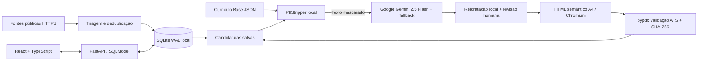

<div align="center">


# Resumatch

**Menos ruído na busca. Mais intenção em cada candidatura.**

Estúdio local de vagas de Tecnologia, currículos A4 e acompanhamento de candidaturas.

[](https://github.com/GustavoHFS/Resumatch/actions)
[](https://python.org)
[](frontend/)
[](LICENSE)
[](#privacidade)

[**Experimentar a demonstração →**](https://gustavohfs.github.io/Resumatch/) · [**Baixar para Windows ↓**](https://github.com/GustavoHFS/Resumatch/releases/latest/download/Resumatch-Windows.zip)
</div>

## Por que este projeto existe?

O Resumatch nasceu de uma **necessidade real de uso próprio**: centralizar a busca por vagas para **iniciantes, estágios e posições júnior na área de Tecnologia**. Entre portais com anúncios repetidos, cargos fora do foco e muitas versões de currículo, faltava um fluxo simples para organizar oportunidades e preparar uma candidatura por vez.

A proposta é eliminar ruído dos portais e adaptar o currículo com responsabilidade usando a faixa gratuita do Google Gemini — sujeita à disponibilidade e às cotas do Google. A IA ajuda a organizar fatos reais, não a inventar qualificações. A revisão e o envio continuam sendo seus.

## Comece em 2 passos — Windows

**Pré-requisito:** Python 3.12+ instalado com “Add Python to PATH” e internet na primeira instalação. O launcher usa .NET Framework 4.x, normalmente presente no Windows.

1. **[Baixe o ZIP da Release](https://github.com/GustavoHFS/Resumatch/releases/latest), extraia tudo e abra `Instalar.bat`.** Aguarde a instalação do ambiente Python e do Chromium para PDF. A Release contém a interface pré-compilada: **não precisa de Node.js**.
2. **Abra `Resumatch.exe`.** Preencha ou importe seu Currículo Base, configure seus critérios e conecte uma chave do [Google AI Studio](https://aistudio.google.com/) se quiser adaptar com IA.

> O ZIP estará disponível após a primeira tag `v*` gerar uma Release com sucesso. Não execute dentro do ZIP. Para atualizar, feche o app, preserve `user_data/` e extraia os arquivos públicos na mesma pasta. O instalador não apaga seus dados.

## Um fluxo, quatro abas

| Aba | O que você faz |
| --- | --- |
| **Vagas** | Busca, filtra ou cola anúncios. Inclui descartadas e fora do foco, respeitando os filtros e a ordem cronológica. |
| **Candidaturas** | Salva o que interessa em **A preparar** e abre o cartão diretamente no Estúdio. |
| **Estúdio** | Seleciona exclusivamente candidaturas salvas ou cola uma descrição avulsa. Adapta, revisa, troca a fonte e exporta em A4. |
| **Currículo Base** | Mantém um histórico único e verdadeiro, com importação de PDF/DOCX e edição local. |

**Adaptar no Estúdio** salva a vaga antes de abrir o editor. Exportar um PDF validado vincula a versão ao cartão e muda **A preparar → Currículo pronto**. Um rascunho de IA sozinho não é um PDF pronto. Marcar “Enviada” exige confirmação manual.

## Arquitetura



**Stack:** Python, FastAPI, Pydantic v2, SQLModel, SQLite WAL, httpx/truststore, selectolax, APScheduler, React 18, TypeScript, Vite, CSS Modules, Jinja2, Playwright e pypdf. O launcher C# abre o navegador padrão sem terminal. O Gemini usa HTTP leve, sem SDK pesado, com fallback `gemini-2.5-flash → gemini-2.5-flash-lite → gemini-flash-latest` em caso de modelo indisponível.

## Privacidade

- **Dados no disco local:** perfil, SQLite, configurações, chave, backups e PDFs ficam em `user_data/`, ignorado integralmente pelo Git. Nunca publique essa pasta nem `.env`.
- **`PIIStripper`:** separa contatos e substitui identificadores por placeholders antes da IA. Empregadores/instituições usam tokens como `[[EMP_1]]` e `[[INST_1]]`; a reidratação ocorre localmente. A vitrine ilustra o conceito com `[NOME_CANDIDATO]`, `[EMAIL]` e `[TELEFONE]`.
- **Há comunicação externa:** a busca acessa portais públicos; o Gemini recebe conteúdo mascarado. Revise descrições livres para remover informações confidenciais não reconhecidas. Não há garantia de anonimização absoluta. Consulte os termos do Google para uso dos dados na faixa gratuita.
- **Barreira de publicação:** `scripts/check_privacy.py` bloqueia contatos, segredos, documentos, bancos e fingerprints locais. O nome público do autor é permitido apenas nos arquivos de crédito autorizados — não libera telefone, endereço ou e-mail.
- **Sem candidatura automática:** nada de preencher formulários ou enviar currículos em massa. Portais podem exigir login e confirmação manual.

O primeiro arranque usa **exemplos vazios** em `examples/`. Dados sintéticos ficam somente nos testes e na [vitrine estática](docs/), que não chama o backend nem o Gemini e não usa analytics.

## Desenvolvimento

Para compilar do código-fonte, instale também Node.js 22+ e execute `Instalar.bat`. Para testes:

```powershell
python -m venv .venv
.venv\Scripts\python -m pip install -e ".[dev]"
.venv\Scripts\python -m playwright install chromium-headless-shell
npm --prefix frontend ci
npm --prefix frontend run build
.venv\Scripts\pytest -v
.venv\Scripts\python scripts/check_privacy.py
```

Opcional: instale a proteção de commit com `.venv\Scripts\python scripts/install_hooks.py`. Para iniciar por terminal: `.venv\Scripts\python scripts/start_app.py`. A API local fica em `/docs`. Feche o aplicativo antes de atualizar arquivos ou executar manutenção.

### Docker

```sh
docker compose -f infra/docker-compose.yml up --build
```

Acesse `http://localhost:8000`. O volume aponta para `./user_data` na raiz. Para encerrar: `docker compose -f infra/docker-compose.yml down`. Não remova dados/volumes privados. `infra/Dockerfile.dockerignore` protege o contexto raiz durante o build.

### Estrutura

```text
Instalar.bat           instalação guiada para Windows
assets/               ícone do launcher
backend/app/          API, domínio, IA, privacidade e PDF A4
backend/tests/        testes isolados e dados sintéticos
frontend/             interface React/TypeScript
examples/             configurações iniciais vazias
infra/                Dockerfile, Compose e regras de isolamento
scripts/              launcher, scanner e pacote de Release
docs/                 demonstração autocontida para GitHub Pages
.github/workflows/    CI e Release por tags v*
user_data/            PRIVADO, nunca versionado
Resumatch.exe         gerado localmente, nunca versionado
```

## CI, Releases e GitHub Pages

Pushes e PRs em `main` verificam privacidade, testes e build da interface no Windows. Publicar uma tag como `v2.2.1` executa os mesmos gates, compila o launcher e cria `Resumatch-Windows.zip` usando somente arquivos públicos permitidos e a interface compilada. Nenhum dado local é empacotado.

Para publicar a vitrine: **Settings → Pages → Deploy from a branch → `main` → `/docs`**. Ela funciona também abrindo `docs/index.html` diretamente, sem servidor. As fontes e o logo são locais. As ações não alteram automaticamente a configuração de Pages da conta.

## Autoria e licença

Desenvolvido por **Gustavo Henrique Francisco da Silva**. [Licença MIT](LICENSE), Copyright © 2026. As fontes incluídas preservam sua [licença SIL Open Font License](docs/assets/fonts/LICENSE-OFL.txt).
