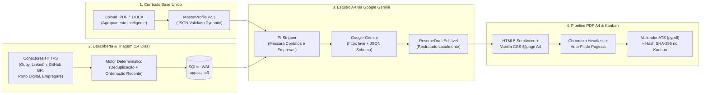

<div align="center">

# 🎯 Resumatch `v2.1`

**Estúdio Local de Busca de Vagas, Adaptação Inteligente de Currículos A4 (ATS) e Gestão de Candidaturas**

[](https://www.python.org/)
[](https://fastapi.tiangolo.com/)
[](https://sqlmodel.tiangolo.com/)
[](https://react.dev/)
[](#)
[](https://playwright.dev/)
[](./Dockerfile)
[](#)

<p align="center">
  <em>Transforme um único Currículo Base em documentos A4 limpos, fiéis à sua trajetória real e sob medida para cada vaga — rodando 100% na sua máquina, com privacidade absoluta.</em>
</p>

</div>

---

## 💡 Por que o Resumatch existe?

Quem busca recolocação ou início de carreira costuma enfrentar dois extremos ruins: manter dezenas de arquivos `.docx` manuais espalhados em pastas **ou** recorrer a ferramentas online que desconfiguram o layout, expõem dados pessoais sensíveis e inventam experiências.

O **Resumatch v2.1** resolve esse fluxo de ponta a ponta em um único aplicativo desktop/web local:

| Para quem analisa (RH & Recrutadores) 🤝 | Para quem desenvolve (Engenharia de Software) ⚙️ |
| :--- | :--- |
| **Zero envios robóticos em massa (Spam):** o sistema nunca preenche formulários às cegas; toda candidatura exige revisão e confirmação humana. | **Arquitetura desacoplada e enxuta:** Backend assíncrono em `FastAPI` + `Pydantic v2` servindo uma SPA em `React + TypeScript + Vanilla CSS` em processo único. |
| **Fidelidade factual rigorosa:** a IA apenas seleciona, prioriza e redige melhor o que já existe no Currículo Base do candidato — sem inventar empresas ou cargos. | **Privacidade por Design (`PIIStripper`):** nome, telefone, e-mail, links e empresas são mascarados localmente antes de qualquer chamada externa de IA e reidratados no retorno. |
| **PDF A4 limpo para sistemas ATS:** coluna única semântica, fontes embutidas offline e links clicáveis verificados automaticamente após cada exportação. | **Qualidade auditável:** persistência `SQLite WAL`, validação pós-renderização via `pypdf` (`SHA-256`) e *hook* `pre-commit` bloqueando vazamento de dados pessoais no Git. |

---

## ✨ Como Funciona na Prática (Fluxo em 4 Passos)

1. **📄 Monte ou Importe seu Currículo Base Único:**
   Envie seu currículo atual em **`.pdf` ou `.docx`** (preenchimento automático da estrutura) ou escreva livremente todo o seu histórico em um único lugar — sem precisar fatiar versões por área.
2. **🔎 Descubra ou Cole uma Vaga:**
   Busque oportunidades em fontes públicas `HTTPS` com triagem automática em português claro (compatibilidade, modalidade, localização e canal de envio) ou cole a descrição de qualquer vaga.
3. **🪄 Gere e Edite o Currículo Sob Medida:**
   Com 1 clique, a IA analisa seu Currículo Base completo diante da vaga, prioriza as seções mais fortes e adapta as descrições destacando suas entregas relevantes. Você visualiza a **Folha A4 ao vivo**, edita qualquer texto ou exclui qualquer item antes de finalizar.
4. **📑 Exporte o PDF A4 Auditado e Acompanhe no Kanban:**
   Exporte um PDF A4 impecável (1 ou 2 páginas com ajuste automático de cabimento) e acompanhe cada etapa no quadro Kanban até a confirmação de envio manual.

---

## 🏗️ Arquitetura do Sistema (`v2.1`)



---

## 🛠️ Stack Tecnológica

### Backend & Domínio
- **Python 3.12+ & FastAPI** — API REST assíncrona, *lifespan* gerenciado e entrega estática integrada da SPA.
- **Pydantic v2 & Pydantic Settings** — validação estrita de contratos (`MasterProfile` v2.1, `ResumeDraft`, configurações) e escrita atômica em disco com backups rotativos.
- **SQLModel + SQLite (`PRAGMA journal_mode=WAL`)** — banco relacional local rápido, sem dependência de servidores externos e zero armazenamento de binários pesados.
- **httpx + truststore + selectolax + APScheduler** — conectores `HTTPS` assíncronos respeitando `robots.txt`, *rate-limit* por domínio, filtro de 14 dias, deduplicação entre portais e agendamento opcional.
- **Motor IA Exclusivo Google Gemini (`httpx` puro, zero SDKs pesados)** — conexão guiada em 2 cliques com **Google Gemini** (`gemini-2.5-flash`) e saída JSON estruturada.

### Motor de Documentos A4 & Validação ATS
- **Jinja2 + HTML5 Semântico + Vanilla CSS (`@page { size: A4 portrait }`)** — tipografia editorial com fontes `Libre Franklin` (`.woff2`) embutidas offline, sem colunas duplas ou tabelas de layout que confundem leitores ATS.
- **Playwright (Headless Chromium Sob Demanda)** — navegador iniciado de forma preguiçosa (*lazy*), reutilizado entre exportações, bloqueado contra requisições externas e encerrado automaticamente após ociosidade.
- **pypdf (`ATS Validator`)** — inspeciona o PDF gerado garantindo contagem exata de páginas (`auto_fit`), extração linear de texto e preservação de links clicáveis (`GitHub`, `LinkedIn`, portfólio).

### Frontend & Experiência Desktop
- **React 18 + TypeScript + Vite** — compilação ultrarrápida e tipagem ponta a ponta.
- **100% Vanilla CSS (`tokens.css` + CSS Modules)** — zero Tailwind, zero bibliotecas pesadas de componentes e zero CSS-in-JS em tempo de execução.
- **Executável Nativo (`Resumatch.exe`)** — abre em 1 clique como aplicativo nativo na barra de tarefas com ícone Chibi dedicado, sem abrir janelas de terminal, e encerra o servidor automaticamente ao fechar a janela.

---

## 🔒 Governança de Privacidade e Isolamento de Dados

Este repositório foi projetado desde o primeiro commit para ser **100% seguro em portfólio público**:

- 📁 **Isolamento total em `./user_data/`:** seu perfil real, banco SQLite, chaves de API, backups automáticos e PDFs gerados vivem exclusivamente dentro de `./user_data/` (bloqueado no `.gitignore` e no `.dockerignore`).
- 🧑‍💻 **Persona fictícia pronta para demonstração:** a pasta pública [`examples/`](./examples) utiliza apenas dados fictícios (*Marina Alves Costa*, Belo Horizonte/MG) para que qualquer recrutador ou desenvolvedor teste o sistema imediatamente.
- 🛡️ **Scanner Anti-Vazamento em `pre-commit`:** o script [`scripts/check_privacy.py`](./scripts/check_privacy.py), instalado automaticamente em `.git/hooks/pre-commit`, barra qualquer tentativa acidental de versionar `.pdf`, `.docx`, `.sqlite3`, chaves secretas ou dados pessoais.
- 🕵️ **Mascaramento Reversível na IA (`PIIStripper`):** ao gerar ou importar um currículo via Google Gemini, e-mail, telefone, bairro, links e nomes de empregadores/instituições são substituídos por *placeholders* (`[[EMP_1]]`, `[[INST_1]]`) e restaurados localmente na sua máquina.

---

## 🚀 Como Executar o Projeto

### Opção 1 — Via Docker (Recomendado para Avaliação Rápida em 1 Comando)

```bash
docker compose up --build
```

Acesse **`http://localhost:8000`**. Se a pasta `./user_data/` estiver vazia, o container carrega automaticamente o perfil demonstrativo de `examples/` (*Marina Alves Costa*) e inicializa o banco SQLite.

---

### Opção 2 — Modo Aplicativo Local (Windows / Linux / macOS)

#### 1. Pré-requisitos
- **Python `3.12+`**
- **Node.js `20+` / `22 LTS`**

#### 2. Instalação Inicial
```powershell
# 1. Criar e ativar o ambiente virtual
python -m venv .venv
.\.venv\Scripts\Activate.ps1

# 2. Instalar dependências do backend e o motor Chromium A4
pip install -e ".[dev]"
playwright install chromium-headless-shell

# 3. Ativar o hook de privacidade e inicializar dados de exemplo (se user_data/ estiver vazio)
python scripts/install_hooks.py
python scripts/bootstrap_demo.py
```

#### 3. Abrir em 1 Clique
- **No Windows:** gere o executável nativo com `python scripts/build_launcher_exe.py` (feito uma única vez) e dê duplo clique em **`Resumatch.exe`** na raiz do projeto. Ele inicia silenciosamente sem abrir CMD, exibe o ícone Chibi na barra de tarefas e encerra o servidor sozinho ao fechar a janela.
- **Via Terminal:**
  ```bash
  python scripts/start_app.py
  ```
- **Documentação interativa da API (Swagger/OpenAPI):** disponível em `http://127.0.0.1:8000/docs` enquanto o app estiver aberto.

---

## 📂 Estrutura de Pastas

```text
resumatch/
├── assets/                  # Ícone multi-tamanho resumatch.ico gerado via Pillow
├── backend/
│   ├── app/
│   │   ├── adapters/        # Google Gemini (httpx), PIIStripper, Chromium PDF e pypdf QA
│   │   ├── api/             # Rotas REST (/api/profile, /api/resumes, /api/jobs, /api/applications)
│   │   ├── connectors/      # Cliente HTTP seguro (HTTPS, robots.txt, 8s timeout) e conectores de vagas
│   │   ├── core/            # Configurações Pydantic, guarda de caminhos e motor SQLite WAL
│   │   ├── domain/          # Triagem determinística, deduplicação entre portais e normalizador de datas
│   │   ├── models/          # Schemas enxutos v2.1 (MasterProfile, ResumeDraft) e entidades SQLModel
│   │   ├── services/        # Importação inteligente .pdf/.docx, geração IA, PDF A4 e escrita atômica
│   │   └── templates/       # Template HTML5 + Vanilla CSS A4 + seletor de fontes ATS offline
│   └── tests/               # Suíte automatizada pytest (ASGITransport + MockTransport)
├── frontend/                # SPA em React 18 + TypeScript + Vite + Vanilla CSS Puro (Design Altitude)
├── examples/                # Configurações públicas fictícias (Marina Alves Costa)
├── scripts/                 # build_launcher_exe.py, generate_icons.py, start_app.py, check_privacy.py
├── user_data/               # Workspace privado ignorado pelo Git (perfil real, SQLite, backups e PDFs)
├── Dockerfile               # Build multi-stage (Node 22 Alpine -> Python 3.12 Slim + Chromium)
├── docker-compose.yml       # Subida completa em 1 comando
└── Resumatch.exe            # Executável nativo Windows (compilado localmente, ignorado no Git)
```

---

## 🧪 Testes Automatizados e Auditoria de Privacidade

```bash
# 1. Executar toda a suíte de testes de backend, importação DOCX/PDF e validação A4 ATS
pytest -v

# 2. Validar tipagem TypeScript e gerar o pacote estático de produção do Frontend
cd frontend && npm run build && cd ..

# 3. Executar a varredura completa anti-vazamento de dados pessoais
python scripts/check_privacy.py
```
